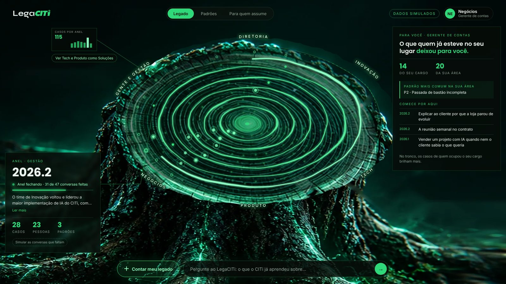

# LegaCITi

**A memória coletiva do CITi.** O LegaCITi guarda o que cada geração viveu, encontra padrões que nenhuma pessoa sozinha conseguiria ver e devolve isso para quem está trabalhando agora.

Projeto de Beatriz para o desafio de Inovação do Processo Seletivo do CITi 2026.2.

- **No ar:** https://legaciti.vercel.app
- **Documentação completa:** entregue junto com o projeto (plataforma, funcionalidades, tecnologias e uso de IA)

> **Dados simulados.** Personagens, clientes e casos da demonstração são fictícios. O produto não mostra nenhum nome de pessoa.



## O que é

O centro do LegaCITi é o corte de um tronco: cada anel é uma gestão, cada ponto é um caso vivido por alguém e cada fatia é uma área. Os casos entram por uma conversa guiada pela IA em três momentos (fim de projeto, fim de gestão e despedida) e voltam no dia a dia de quem trabalha.

| Funcionalidade | O que faz |
|---|---|
| Entrada por cargo | Tudo o que a pessoa vê se adapta à área e ao cargo, inclusive para New Pigs |
| Tronco do legado | 7 gestões em anéis, 115 casos em pontos; os do cargo de quem entrou brilham mais |
| Para você | Casos do cargo e da área, padrão mais comum e por onde começar |
| Pergunte ao LegaCITi | Respostas só com casos registrados, sempre citando a fonte |
| Contar meu legado | Entrevista por texto ou voz; o caso nasce no anel ao vivo e o anel fecha |
| Padrões | Liga casos do mesmo padrão através das gerações |
| Para quem assume | O legado de todos que já ocuparam um cargo, com citações |
| Painel da diretoria | Conversas por área, padrões da gestão, legado que apoia 2027.1 e pauta da reunião |

## Uma IA que não inventa

1. Pedidos para sair do papel são barrados antes de chegar à IA.
2. Sem caso parecido na busca local, a IA nem é chamada.
3. A IA recebe só os casos encontrados, tratados como dados e nunca como ordens.
4. O servidor descarta respostas com citações de casos que não foram enviados.
5. O servidor descarta respostas com números que não estão nos casos usados.
6. Se a IA falhar, o site mostra só os casos reais mais próximos.
7. Na entrevista, a pessoa revisa o caso antes de registrá-lo.

## Como rodar

```bash
npm install
cp .env.example .env.local   # coloque a sua GEMINI_API_KEY
npm run build && npm start
```

Sem chave, tudo funciona no modo de segurança: busca, entrevista com roteiro fixo e guias montados só com os dados.

`/api/saude` mostra se a IA está respondendo e em quanto tempo, sem revelar a chave.

## Estrutura

| Caminho | Conteúdo |
|---|---|
| `src/app/page.js`, `src/app/tronco` | Tela de entrada e tela do tronco |
| `src/app/api/perguntar` | Pergunte ao LegaCITi |
| `src/app/api/entrevista` | Conversa de legado (captura) |
| `src/app/api/bastao` | Para quem assume |
| `src/app/api/diretoria` | Pauta da reunião de diretoria |
| `src/app/api/saude` | Diagnóstico da IA |
| `src/components` | Tronco, palco, entrevista, painel da diretoria, marca |
| `src/lib/ia` | Regras da IA, busca local, conferências e chamada ao Gemini |
| `src/lib/geometria.js` | Anéis, fatias e posição de cada caso |
| `src/data` | 115 casos, personagens, gestões e cargos |
| `simulacao` | Versões legíveis da simulação (bastidores) |

## Tecnologias

Next.js 16 · SVG desenhado em código · Gemini 3.5 Flash-Lite (nível gratuito) · Web Speech API · Vercel · GitHub · Playwright (testes) · Python e OpenCV (tratamento da imagem do tronco, gerada com GPT Image 2.5).

Construído com o Claude (Anthropic): ideação, código, dados da simulação, testes e documentação, com todas as decisões de produto, conteúdo e visual tomadas por Beatriz.
